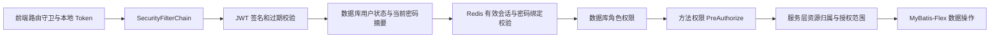

# Security 链路检查（2026-10-21）

初次检查范围：本地前后端代码、Spring Security 认证与授权链路、相关业务服务，以及接口复现。初次审查没有修改业务代码。

**2026-10-22 后台管理修复：** 补充审查发现的 8 组 P2 已全部修复，覆盖评论点赞身份、用户分页及角色筛选、文章删除返回值、分类标签引用与筛选、输入校验和角色关联清理，另补齐文章时间字段的缓存序列化，见 [后台管理修复记录](ADMIN_MANAGEMENT_FIX.md)。第 1 项草稿编辑、删除由用户确认为尚未实现的功能，随后也已按追加要求开发完成；最新后端 312 项、前端 50 项回归及构建通过，前后端保持关闭，见 [草稿管理功能记录](DRAFT_MANAGEMENT_FIX.md)。上一轮另有 19 项实际 HTTP 验收；原始证据见 [后台管理审查记录](ADMIN_MANAGEMENT_REVIEW.md)。下文“本轮未发现新的待修问题”等描述对应之前各轮的范围和当时状态。

**当前结论：原清单中的 P1/P2、审查边界及后续两项配置风险均已修复。** 第 4 项 JWT 密钥已移出跟踪配置并完成本地轮换，见 [JWT 密钥修复记录](JWT_SECRET_FIX.md)。数据库进一步改用受限专用账号、轮换已写入代码的 root 密码，8 份配置改为外部注入，邮件调试默认关闭；最新 259 项后端回归、6 项实际 HTTP 验收通过，前后端已按要求关闭，见 [凭据与邮件配置修复记录](CONFIG_CREDENTIALS_FIX.md)。本轮未发现新的待修问题，结论限定于已审查范围。以下“暂缓”等描述属于之前各轮的历史记录。

后续修复：第 1 项授权越权已修复，并接入 SUPER_ADMIN 顶层角色；配套修复第 6 项中的超级管理员目标保护、角色继承与空权限列表问题。现有 `admin`（用户 ID 1）已按要求提升为首位超级管理员。修复范围、数据库变化和验证结果见 [授权修复记录](AUTHORIZATION_FIX.md)。其他问题仍按下文记录待处理；Docker/Elasticsearch 未调整。下列原始复现描述保留为历史证据。

第 2 项草稿与关联评论泄露现也已修复，详见 [草稿可见性修复记录](DRAFT_VISIBILITY_FIX.md)。列表、搜索、分页计数、详情缓存与评论操作统一校验文章可见范围，58 项回归通过。

第 3 项正文 XSS 现已修复，详见 [渲染安全修复记录](XSS_RENDERING_FIX.md)。正文与后台预览共用关闭原始 HTML、最终白名单清洗的渲染器；登录响应中的 Token 调试输出已删除，26 项安全回归通过。

第 5 项 Token 撤销现已修复，详见 [Token 撤销修复记录](TOKEN_REVOCATION_FIX.md)。登录登记 Redis 有效会话，退出撤销当前会话，改密使账号全部旧会话失效；后端 76 项、前端 34 项回归通过。第 4 项密钥配置按用户要求暂缓，本轮没有修改密钥。

首项 P2 注册问题现已修复，详见 [注册完整性修复记录](REGISTRATION_INTEGRITY_FIX.md)。注册保存已验证邮箱，验证码与链接原子消费，复用现有邮箱唯一索引并保证账号与角色事务一致；后端 103 项、前端 34 项回归通过。

文章点赞 P2 现已修复，详见 [文章点赞修复记录](ARTICLE_LIKE_FIX.md)。点赞身份固定为服务端当前用户，已登录读者均可操作已发布文章；记录与计数在同一事务内更新，详情读取覆盖缓存中的旧计数。包含 13 项点赞专项验证在内，后端 116 项回归通过。

邮箱认证账号状态与缺失 User-Agent 两项 P2 现已修复，详见 [登录完整性修复记录](LOGIN_INTEGRITY_FIX.md)。邮箱、手机号 Provider 签发前检查禁用/锁定等状态，NID 登录正确识别锁定；登录日志兼容缺失、异常及过长浏览器信息。新增 39 项验证，后端安全与业务回归共 155 项通过（排除既有独立模块启动模板，范围与限制见修复记录）。

最后两项明确列出的 P2（CORS 与错误响应）也已修复，详见 [HTTP 安全修复记录](HTTP_SECURITY_FIX.md)。合法预检先于认证，实际请求仍鉴权；全局异常返回真实 HTTP 状态，保留业务码并隐藏内部异常详情。前端同步处理实际 4xx 与登录失败 401，避免误清理有效会话。后端安全/业务回归 185 项、前端 47 项通过；密钥暂缓和下文独立审查边界继续保留。

下文原“尚未动态验证的边界”现也已逐项验证并修复，见 [边界验证修复记录](SECURITY_BOUNDARIES_FIX.md)。补齐认证/邮件/验证码原子限额、可信代理 IP 规则、文章状态管理权限，以及带再次验证与层级保护的密码重置；配套修复 JWT 角色前缀重复问题。后端安全/业务回归 233 项、前端 50 项及运行中 15 项 HTTP 验收通过。JWT 密钥仍暂缓，外部网关和实际 SMTP 投递不据此宣称已验证。

## 当前请求链路

密码登录另经 `AuthenticationManager → DaoAuthenticationProvider / EmailAuthenticationProvider → AuthLoginUser → JWT + Redis 会话登记`。已完成修复与仍待处理的登录注册、接口授权、错误/CORS 等问题分列如下。

## 优先修复的问题

### 1. P1：拥有 user:create 的账号能给自己的角色增加其他权限（已修复）

修复结果：权限创建、修改、删除、分配及角色写操作，在控制器和服务层均限定 SUPER_ADMIN；业务权限无法再换取授权管理能力。提交的角色、权限 ID 先验证再替换，内置角色编码受到保护，SUPER_ADMIN 自动具有全部有效权限且不接受显式覆盖。

- 入口：`POST /permissions/save` 仅要求 `user:create`。服务直接按请求中的 `roleId` 替换全部权限，不检查调用者是否有权管理该角色，也不限制可授予的权限范围。
- 已复现：临时账号起初只有 `user:create`；将其角色权限改为 `user:create + user:update` 后，数据库查询确认新增权限已生效。修改的是临时角色，最终事务回滚。
- 影响：拥有用户创建权限的账号可以扩大自身权限，还可操作任意目标角色的权限。前端是否展示权限管理入口不影响此接口的调用。
- 建议：使用专门的角色授权权限；在 `PermissionService` 中验证目标角色、操作者层级、可授予权限集合，并保护内置高权限角色。
- 位置：[PermissionController.java:39](D:/IDEA_project/nebula-blog/nebula-role/src/main/java/com/nebula/role/controller/PermissionController.java:39)、[PermissionServiceImpl.java:80](D:/IDEA_project/nebula-blog/nebula-role/src/main/java/com/nebula/role/service/impl/PermissionServiceImpl.java:80)。

### 2. P1：通用文章与评论接口泄露草稿内容（已修复）

修复结果：普通用户仅能读取已发布或本人未发布文章，ADMIN 且有 `article:list`、SUPER_ADMIN 可管理读取未删除文章。评论的列表、搜索、计数和操作复用文章可见性条件；详情先查数据库再读取缓存，未发布预览不使用共享缓存。个人主页的公开评论关联查询排除未发布及已删除文章。以下为修复前复现记录。

- `GET /articles` 只要求 `article:list`；查询没有按发布状态、本人或管理角色限制结果。请求中的 `userId` 是筛选条件，不能证明调用者有权读取该用户的草稿。
- `GET /comments?articleId=...` 允许任意已登录账号调用，也不校验目标文章的可见性。
- 已复现：仅有 `article:list` 的临时账号读取到另一个用户的草稿正文；无业务权限的已登录临时账号读取到该草稿下的评论。
- 建议：区分公开阅读、本人管理与后台管理的查询策略，并在文章/评论对应服务中统一文章可见性判断。此前个人主页接口的私有字段保护仍然有效，但其他入口存在独立缺口。
- 位置：[ArticleServiceImpl.java:61](D:/IDEA_project/nebula-blog/nebula-article/src/main/java/com/nebula/article/service/impl/ArticleServiceImpl.java:61)、[CommentServiceImpl.java:45](D:/IDEA_project/nebula-blog/nebula-comment/src/main/java/com/nebula/comment/service/impl/CommentServiceImpl.java:45)。

### 3. P1：文章正文存在存储型 XSS 风险，可影响登录凭证（已修复）

修复结果：正文与后台编辑预览统一使用 `renderMarkdown`，关闭原始 HTML，并使用 DOMPurify 对最终输出按白名单清洗。手写 HTML 显示为文本，普通 Markdown 和高亮代码保留；清洗不可用时只返回转义文本。登录 Token 和评论响应调试日志已删除。以下为修复前复现记录。

- 正文渲染开启 `MarkdownIt({html:true})`，输出直接交给 `v-html`，没有 HTML 清洗步骤。
- 已验证：当前安装版本在此配置下保留 `` 的 `onerror` 属性。没有向现有文章写入测试脚本，也没有读取、传输真实 Token。
- 影响条件：含恶意 HTML 的内容被发布并进入读者页面后，事件处理代码可能执行。前端 Token 存在同源 `localStorage` 中，恶意脚本可读取或直接以用户身份发起请求。登录组件还会把含 Token 的整个登录响应输出到控制台。
- 建议：优先关闭原始 HTML；若需要支持，使用经过维护的 HTML 清洗组件并明确允许列表。删除登录响应调试输出。Markdown-it 官方同样要求开启 HTML 时配合外部清洗，见 [官方安全说明](https://github.com/markdown-it/markdown-it/blob/master/docs/safety.md)。
- 位置：[ArticleContent.vue:18](D:/Webstorm_project/nebula_blog/src/views/home/article/detail/components/ArticleContent.vue:18)、[auth.ts:22](D:/Webstorm_project/nebula_blog/src/stores/auth.ts:22)、[LoginForm.vue:36](D:/Webstorm_project/nebula_blog/src/views/login/components/LoginForm.vue:36)。

### 4. P1：JWT 签名密钥是 Git 跟踪配置中的字面量（已修复）

已改为外部注入及 Git 忽略的本地配置树，使用新的随机密钥；缺失、编码错误和不足 32 字节时启动失败。旧密钥 Token 即使有有效 Redis 会话也被拒绝，新 Token 的登录、退出和重启行为均已验证。见 [JWT 密钥修复记录](JWT_SECRET_FIX.md)。以下保留初次审查记录。

- 已确认 `application.yaml` 受 Git 跟踪，`jwt.secret` 使用固定值而非环境注入；报告不记录密钥内容。
- 影响条件：持有这份配置及相同部署密钥的人可以签发指定用户 ID 的 Token。当前过滤器会按该 ID 载入对应用户的真实权限。
- 当前过期时间为 `604800000ms`，即 7 天。这不是密钥长度不足问题，而是密钥的分发、保密与环境隔离问题。
- 建议：迁移到环境变量或密钥管理；不同环境使用不同密钥。如果该值已经对外共享，应进行轮换，并预期已有登录会失效。
- 位置：[application.yaml:55](D:/IDEA_project/nebula-blog/nebula-start/src/main/resources/application.yaml:55)、[JwtUtil.java:63](D:/IDEA_project/nebula-blog/nebula-auth/src/main/java/com/nebula/auth/util/JwtUtil.java:63)。

### 5. P1：修改密码和前端退出无法撤销旧 Token（已修复）

修复结果：每次登录生成独立 `jti` 并登记 Redis 有效会话，统一过滤器同时校验签名、过期时间、账号状态及会话与当前数据库密码的绑定。`POST /auth/logout` 撤销当前会话，前端三个退出入口均等待服务端结果；改密通过 MyBatis-Flex 条件更新，使该账号所有旧会话失效，且不影响其他用户。Redis 不可用返回 503，不降级为仅验签。没有 `jti` 的历史 Token 和未登记 Token 返回 401，需要重新登录一次。以下为修复前复现记录。

- 修改密码只更新数据库密码，JWT 校验不比较会话版本或密码变更时间，也没有服务端退出撤销流程。
- 已复现：临时用户成功改密后，改密前签发的 Token 仍可通过鉴权访问接口。
- 影响：密码泄露后的改密无法终止已经获得 Token 的其他会话；前端退出仅移除本机保存的状态。
- 建议：引入账号会话版本或服务端撤销记录，在 JWT 过滤器统一检查；改密使旧版本失效，退出按会话撤销。若会话状态落库，继续使用 MyBatis-Flex。
- 位置：[AuthServiceImpl.java:94](D:/IDEA_project/nebula-blog/nebula-auth/src/main/java/com/nebula/auth/service/impl/AuthServiceImpl.java:94)、[JwtUtil.java:87](D:/IDEA_project/nebula-blog/nebula-auth/src/main/java/com/nebula/auth/util/JwtUtil.java:87)、[auth.ts:48](D:/Webstorm_project/nebula_blog/src/stores/auth.ts:48)。

### 6. P1：ADMIN 可以禁用 SUPER_ADMIN，用户操作层级不一致（已修复）

修复结果：编辑用户角色限定 SUPER_ADMIN，ADMIN 无法禁用或删除超级管理员；删除接口改用 `user:delete`。禁止禁用、删除、注销或移除最后一位可用超级管理员的顶层角色，相关检查与写入在事务内完成，并锁定超级管理员绑定与有效用户记录。

- 编辑用户要求超级管理员，但禁用/删除仅检查“本人或管理员”，没有保护目标用户的更高角色。
- 已复现：只绑定 ADMIN 角色的临时账号，通过状态接口禁用了绑定 SUPER_ADMIN 角色的另一个临时账号。
- 影响：低一级管理员可以使超级管理员无法继续使用账号。同一用户模块的编辑、禁用和删除采用了不同的层级策略。
- 建议：在 `UserService` 中统一目标用户保护规则，限制对同级/更高角色、最后一个可用超级管理员及关键内置账号的操作。删除接口当前还使用 `user:update`，应与实际删除权限统一。
- 位置：[UserServiceImpl.java:87](D:/IDEA_project/nebula-blog/nebula-user/src/main/java/com/nebula/user/service/impl/UserServiceImpl.java:87)、[UserServiceImpl.java:293](D:/IDEA_project/nebula-blog/nebula-user/src/main/java/com/nebula/user/service/impl/UserServiceImpl.java:293)、[UserController.java:63](D:/IDEA_project/nebula-blog/nebula-user/src/main/java/com/nebula/user/controller/UserController.java:63)。

## 其他已确认问题

| 优先级 | 问题与验证结果 | 建议与代码位置 |
| --- | --- | --- |
| P2（已修复） | 修复前：注册时没有保存已验证邮箱，同一注册凭证的并发读取可创建多个账号，二者邮箱均为空。 | 已保存并规范化邮箱；验证码验证与链接签发由 Redis Lua 原子执行，注册链接使用 GETDEL 原子消费；复用 `uk_user_email` 唯一索引，账号与 USER 角色事务写入，回滚按原有效期恢复凭证。真实 Redis/MySQL 并发与邮箱登录验证通过。见 [注册完整性修复记录](REGISTRATION_INTEGRITY_FIX.md)。 |
| P2（已修复） | 修复前：文章点赞验证的是调用者是否为文章作者，却把请求中的 `userId` 写入点赞记录，作者可代替另一个用户创建点赞。 | DTO 移除用户身份字段，旧请求中的 `userId` 被忽略；服务固定使用当前登录用户，普通读者、管理员与超级管理员都只能改变自己的记录。仅已发布且未删除文章可互动，文章行锁与事务保证切换及计数一致，提交后失效缓存且详情总是采用数据库当前计数。见 [文章点赞修复记录](ARTICLE_LIKE_FIX.md)。 |
| P2（已修复） | 原 `AuthLoginUser.getAuthorities()` 在角色或权限任一列表为空时丢弃有效数据。 | 已独立合并角色与权限，统一 `ROLE_` 前缀，并实现 SUPER_ADMIN → ADMIN → USER 的角色继承；登录与 JWT 请求链路均有回归验证。见 [AuthLoginUser.java:44](D:/IDEA_project/nebula-blog/nebula-auth/src/main/java/com/nebula/auth/security/AuthLoginUser.java:44)。 |
| P2（已修复） | 修复前：邮箱 Provider 未检查禁用/锁定，禁用账号收到成功登录响应和 Token，随后才被过滤器拒绝。 | 邮箱、手机号 Provider 使用标准账号状态检查器；NID 身份正确反映锁定，删除及非正常状态均不允许登录。真实邮箱/NID 接口与 AuthenticationManager 手机号分支均已动态验证，拒绝路径不签发 Token。见 [登录完整性修复记录](LOGIN_INTEGRITY_FIX.md)。 |
| P2（已修复） | 修复前：缺失 `User-Agent` 导致日志解析空指针，合法密码也无法完成登录。 | 缺失、空白、无法识别及解析异常均采用 Unknown；请求头控制字符清理、按现有字段长度截断，仍写入真实日志。正常桌面/移动、成功及失败登录均验证通过。见 [登录完整性修复记录](LOGIN_INTEGRITY_FIX.md)。 |
| P2（已修复） | 修复前：CORS 仅配置于 MVC，匿名预检返回 401 且缺少允许源头。 | 唯一明确源配置接入 Security 链，合法预检在 JWT 解析前结束，默认仅允许 localhost/127.0.0.1:5173；非法源、方法、头被拒绝，实际请求仍鉴权。见 [HTTP 安全修复记录](HTTP_SECURITY_FIX.md)。 |
| P2（已修复） | 修复前：方法拒绝返回 HTTP 200/code 403，未知异常向客户端返回内部错误。 | 方法拒绝返回 HTTP 403；输入、业务、认证及服务器错误采用真实 HTTP 状态并保留业务码，未知/数据库异常详情只记录在服务端。前端支持实际 4xx 提示，登录失败不会误清理有效会话。见 [HTTP 安全修复记录](HTTP_SECURITY_FIX.md)。 |

## 代码审查边界（已动态验证并修复）

- **已修复**：原先没有认证失败/验证码预算、跨邮箱来源限额，邮件冷却有并发间隙。现使用真实 Redis 原子计数/冷却，账号别名共用预算，验证码错误耗尽后失效；429 带 Retry-After，保护不可用返回 503。并发及故障验证见修复记录。没有检查外部网关是否另有限速。
- **已修复**：原先客户端可伪造来源 IP。现默认只采用连接对端，只有显式可信代理 CIDR 才解析受限的 X-Forwarded-For 链；日志和限速统一解析，转发策略禁止容器提前改写对端。IPv4/IPv6、伪造和非法链验证通过。
- **已修复**：SUPER_ADMIN 继承已有保护继续有效；文章状态接口及服务改为 ADMIN + article:update，user:update 不再授权发布操作。JWT 角色前缀也统一规范化，受限管理员及直接服务调用均已验证。
- **已修复**：删除原密码重置占位与固定测试邮件，接入标准 JSON、管理员再次验证、目标层级保护与事务写入；重置撤销目标全部旧会话，前端新增对应弹窗。所有有效密码变更只在隔离测试账号上执行并回滚，未改变现有账号密码、未发送真实邮件。

## 已有且有效的保护

- Spring Security 启用方法授权，未放行的接口要求后端认证；用户密码使用 BCrypt。
- JWT 过滤器从数据库重建角色与权限，前端本地保存的 roles/permissions 用于页面控制，不能直接成为后端授权依据。
- 正常/禁用/锁定/删除状态检查有效；已注销、禁用账号的旧 Token 会被过滤器拒绝。邮箱、NID 登录及手机号 Provider 在认证阶段也检查账号状态，禁用/锁定账号不会获得新的 Token。
- 当前使用 Authorization Bearer、禁用 HttpSession，并在 Redis 维护登录会话有效性；本次没有将关闭 CSRF 本身判为漏洞。若以后切换为浏览器自动携带的认证 Cookie，需要重新设计 CSRF 保护。

## 验证与留档

共完成 **11 个问题复现用例**，最后一次运行失败/错误均为 0。这里的“通过”表示成功证明当前有这些问题，不能解释为系统安全测试通过。

- 9 个用例通过真实 MySQL、完整 Spring Security 与 MockMvc 接口链路验证。
- 1 个用例验证身份对象空权限列表处理。
- 1 个用例使用模拟 Redis 的并发读结果和真实 MySQL，验证注册邮箱缺失与重复消费。
- 所有数据库操作使用 MyBatis-Flex，测试数据事务回滚；没有修改既有账号、角色、权限、文章或评论，没有发送邮件，没有提取真实 Token。
- 另对运行中的 8080 服务执行了只读 CORS 预检；对前端 Markdown 解析器执行了不涉及浏览器脚本运行的输出检查。

临时复现代码已移出正常测试目录，以免把“允许漏洞存在”的断言作为项目回归标准。归档位于：

- `nebula-start/target/security-review/SecurityChainAuditTest.java`
- `nebula-start/target/security-review/TEST-com.nebula.start.SecurityChainAuditTest.xml`
- `nebula-start/target/security-review/security-audit-run.log`

本次建议按“授权越界与草稿可见性 → 正文 XSS 与密钥隔离 → Token 撤销与管理层级 → 登录注册及错误/CORS 一致性”分组修复，并把复现断言改为拒绝越权的正式回归测试。框架方法授权原则参考 [Spring Security 6.5 Method Security](https://docs.spring.io/spring-security/reference/6.5/servlet/authorization/method-security.html)。
